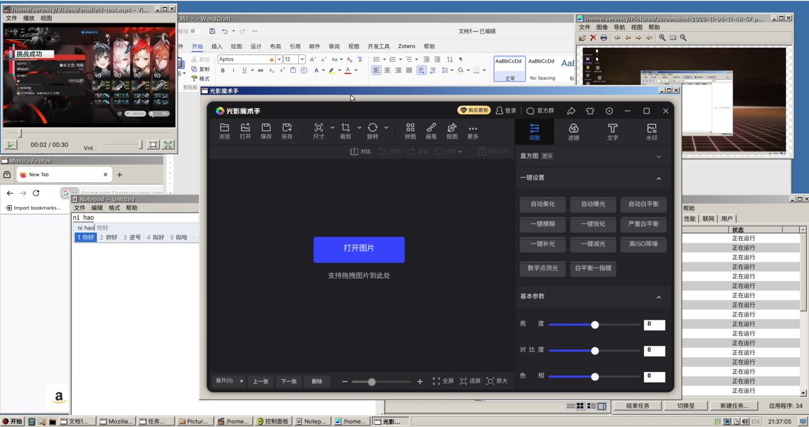
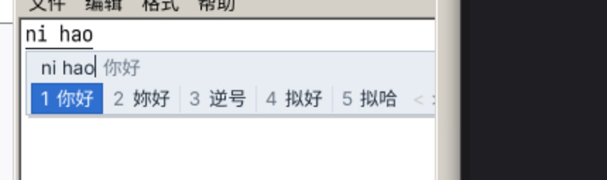
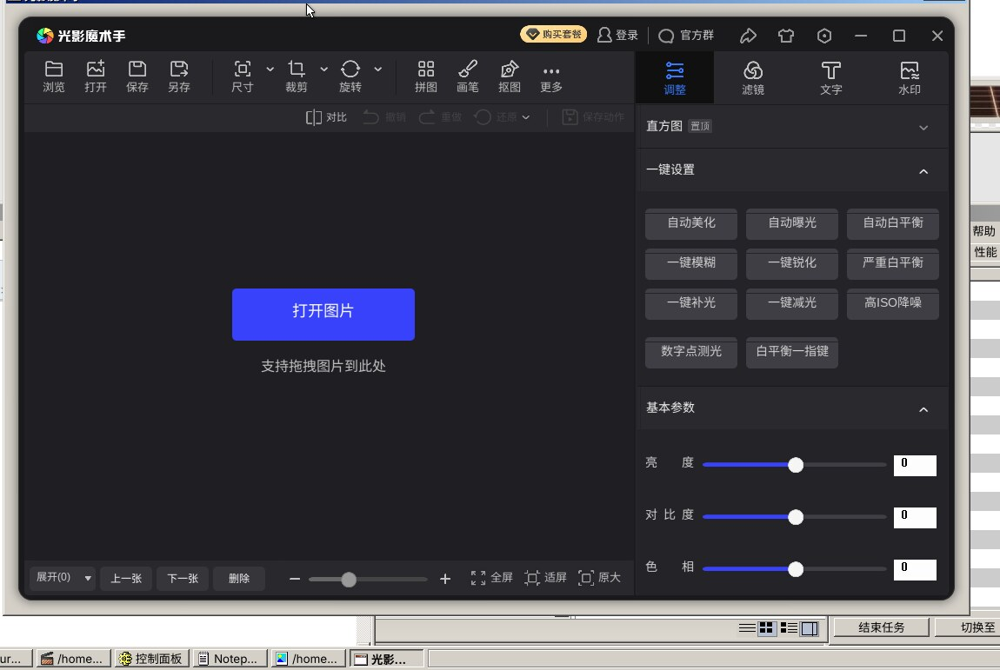
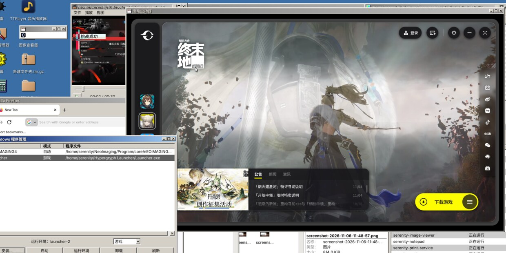
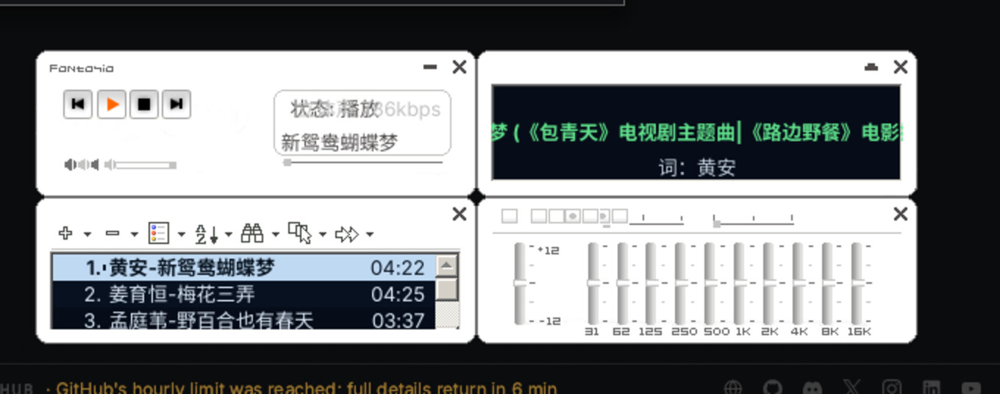

# SerenityOS Linux GUI —— 桌面环境移植

> **这不是 SerenityOS 内核。** 这里把 SerenityOS 的**桌面环境**（WindowServer + LibGUI + 全套应用）
> 移植到 **Linux** 上运行：界面保持 90 年代 → Windows 2000/Vista 的复古观感，底层直接跑在
> 现成的 Linux 栈上（DRM/KMS、libinput、Wayland/Xwayland、librime、Wine/Proton）。
>
> 一句话原则：**界面复古，架构不复古。** 优先用成熟组件，力气花在配色、窗口装饰、候选窗、
> 字体与图标这些外观层。

[](LICENSE)
[](#运行环境)
[](#已知限制)

---

## 截图

**桌面** —— 视频播放器、WordCraft 文档、Firefox、文件管理器、任务管理器同屏，任务栏与托盘均为自绘：



**中文输入法**（内联拼音 + Serenity 自绘候选窗，蓝底白字）与 **Windows 应用**（光影魔术手，套复古窗框）：

| 输入法 | Windows 应用 |
|---|---|
|  |  |

**Windows 程序管理器**：按 PE 导入表自动判定 `app` / `game`，游戏走 `umu-run + DWProton`，应用走原版 wine：



**TTPlayer（千千静听复刻）**：主窗口 / 播放列表 / 歌词秀 / 十段均衡器 四个独立窗口，皮肤直接吃原版 `Skin.xml` v2：



> 截图来自虚拟机实机（QEMU virtio-vga + DRM/KMS 输出），不是软件渲染拼图。

---

## 这是什么

一个**桌面外壳的移植层**：把 SerenityOS 的 GUI 程序编译成普通 Linux ELF，让它们通过
`/serenity` 运行期前缀、自建 portal 与 IPC 服务跑在 Debian 上。

- **应用**：62/62 个 GUI 应用构建成功（终端、文件管理器、图片查看器、计算器、游戏……）
- **外壳**：`serenity-shell` 单进程 = 桌面图标 + 任务栏 + 开始菜单 + 托盘（explorer.exe 模式）
- **合成**：WindowServer 自己画窗口（KMS dumb buffer + page flip），Wayland/X11/Wine 客户端
  统一桥成 `GUI::Window` 再合成，所以复古边框对所有程序一致
- **汉化**：LibGUI 运行时字符串表 700+ 条，改 ini 即生效，不需重编

## 这不是什么

- 不是 SerenityOS 的 Linux 分支内核，不提供 `pledge/unveil`、不跑 ext2、不接管系统服务
- 不是主题皮肤包：它替换的是整个窗口系统，不是 GTK 主题
- 不是通用 Linux 桌面：目标是「让 Serenity 的桌面在这台机器上像 2000 年那样工作」

---

## 能力概览

| 子系统 | 状态 | 说明 |
|---|---|---|
| 显示 / 输入 | ✅ | DRM/KMS（preferred 模式自适应）+ libinput（绝对坐标 16 位、亚像素累积） |
| 窗口合成 / 装饰 | ✅ | WindowServer 唯一合成层；强制 SERVER_SIDE 复古框（Wine 例外 frameless） |
| Wayland 客户端 | ✅ | `serenity-wlroots-host`（vendored wlroots 0.20 协议版）桥接；Firefox 原生 Wayland 链路打通 |
| X11 客户端 | ✅ | Xwayland + 自研 XWM（中文标题读 `_NET_WM_NAME`） |
| 主题 | ✅ | Windows 2000 / Vista 双态，一键切换并同步 GTK3 / GTK4 / libadwaita |
| 中文输入法 | ✅ | `serenity-engine` 直链 librime；Ctrl+Space 开关；原生 / Wayland / XIM 三条前端共用一条行协议 |
| 文件管理器 | ✅ | Vista/Win7 化：命令栏、地址栏、导航窗格、预览窗格、实时搜索 |
| 任务管理器 | ✅ | Win7 对齐：6 选项卡、进程树、内核进程合并、Ctrl+Alt+Del 接管 |
| 音乐播放器 | 🟡 | TTPlayer 复刻千千静听：四窗口 + 原版 `Skin.xml` v2 皮肤引擎；部分皮肤的控件层仍在打磨 |
| 打印 | 🟡 | CUPS 队列/任务管理 + 服务端页面合成（PDF 逐页栅格化）；属性页待手测 |
| Windows 程序 | ✅ | `serenity-winapp` 原生启动器：游戏 → umu-run + DWProton，应用 → 原版 wine 11 |
| 图标 / 快捷方式 | ✅ | 统一解析（PE 资源、XDG 主题、`.ico`、文件类型表 50 族 / ~600 模式） |
| 剪贴板 | 🟡 | Wayland 内部与系统级可用；X↔Wayland 互通待实测 |

更细的状态矩阵见 [STATUS.md](STATUS.md)，完整技术总纲见 [PROJECT_MASTER.md](PROJECT_MASTER.md)。

---

## 架构（一张图）

```
Wayland 客户端 / X11(Xwayland) / Wine / 原生 Serenity 应用
   │   shm 缓冲、damage、frame 回调节流
   ▼
serenity-wlroots-host      ← 协议宿主：surface → Gfx::Bitmap → GUI::Window
   │
   ▼
WindowServer（LibGUI 软件合成，唯一合成层）
   │   窗口位图 → m_framebuffer（双缓冲）
   ▼
LinuxScreenBackend         ← KMS：按脏矩形逐行 memcpy → dumb buffer → page flip
   ▼
CRTC scanout
```

源码主要在 `Ports/LinuxGUI/`（外壳、桥、输入、会话管理、服务）与 `Userland/`（应用与库）。

---

## 运行环境

| 项 | 要求 |
|---|---|
| 系统 | Debian 13（无桌面）或同类发行版，x86-64 |
| 显示 | 任何能被 DRM/KMS 驱动的输出（真机 / QEMU virtio-vga 均可） |
| 输入 | libinput 可识别的键盘、指针设备 |
| 可选 | `librime`（输入法）、`wine` + `umu-launcher`（Windows 程序）、`cups`（打印） |

## 快速开始

```bash
# 1) 依赖（Debian 13）
sudo scripts/port/00-install-deps.sh

# 2) 可选：预取编译缓存，大幅缩短首次构建
scripts/port/01-fetch-caches.sh

# 3) 构建（Lagom，只建 GUI 相关目标）
scripts/port/02-build.sh

# 4) 安装运行期到 /serenity 并注册 systemd 服务
sudo scripts/port/05-install-prefix.sh --systemd

# 5) 启动桌面
sudo systemctl start serenity-desktop.service
```

真机（物理机）安装用 `sudo scripts/port/06-install-host.sh`：建会话用户、装 unit、编音频
内核模块、切到 `multi-user.target`。回滚用装出来的 `serenity-restore-gnome`。

细节（编译流程、排错、回滚）见 [LINUX_GUI_PORT.md](LINUX_GUI_PORT.md)。

---

## 文档

| 文档 | 内容 |
|---|---|
| **[PROJECT_MASTER.md](PROJECT_MASTER.md)** | **总纲**：硬约束、架构决策（ADR）、状态矩阵、时间线、通用坑速查、待办 |
| [STATUS.md](STATUS.md) | 一页速览：已完成 / 待测试 / 未完成 |
| [WAYLAND_ROADMAP.md](WAYLAND_ROADMAP.md) | Wayland 协议缺口与零拷贝路线（阶段 0–5，含验收与回滚） |
| [LINUX_GUI_PORT.md](LINUX_GUI_PORT.md) | 移植技术细节：环境、脚本、编译、服务、内核模块、上游改动表 |
| [VISTA_THEME.md](VISTA_THEME.md) | Vista 复刻：系统主题管线、Aero 配色、开关与持久化 |
| [README.upstream.md](README.upstream.md) | 上游 SerenityOS 原始 README（作者、特性、构建方式） |

---

## 已知限制

- **实验性**：没有 CI，没有自动化回归；验证主要靠虚拟机实机截图与日志。
- 输入法：引擎协议级断言 28/28 通过，但托盘「中/EN」同步与英文直输仍待 GUI 端到端确认。
- 开始菜单：右键删除可用，**拖拽归类尚未生效**（WindowServer 的 drag 事件派发问题）。
- 性能：输出链路仍有三次拷贝（零拷贝方案见 `WAYLAND_ROADMAP.md` §5）。
- 托盘拖拽、X↔Wayland 剪贴板、打印属性页为已知缺口。

---

## 许可证

本项目是 [SerenityOS](https://github.com/SerenityOS/serenity) 的**派生作品**，遵循上游
**BSD 2-Clause** 许可（见 [LICENSE](LICENSE)）；新增的移植代码同样以 BSD-2-Clause 发布。
SerenityOS 及其作者保留原创部分版权，致谢见 [README.upstream.md](README.upstream.md)。

内核模块 `KernelModules/serenity_compat/` 为独立 out-of-tree 模块；
`wlroots/` 为 vendored 上游代码（MIT），许可见其目录内声明。
